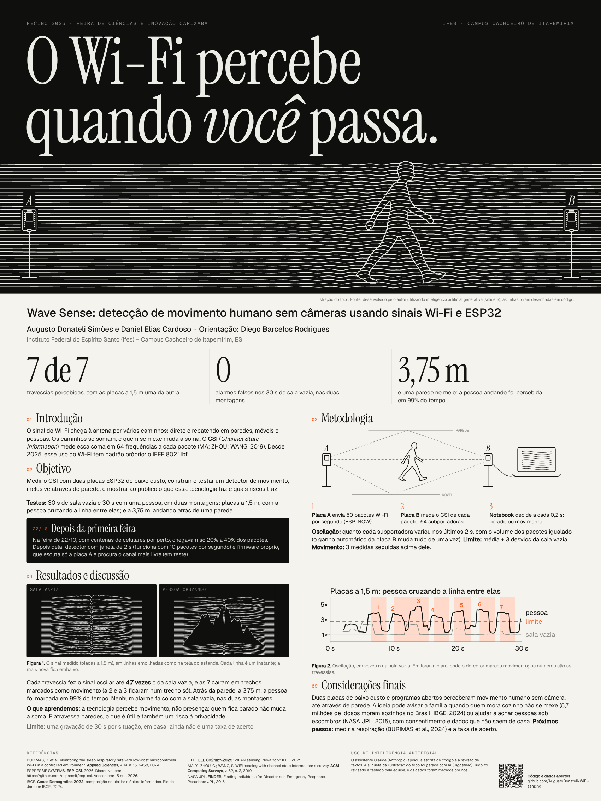

# Banner da Fecinc 2026 (90 × 120 cm)

**Para imprimir: [`banner-fecinc.pdf`](banner-fecinc.pdf).** Prévia: [`previa.png`](previa.png).



## Na gráfica

- **Tamanho:** 90 × 120 cm, em pé. O PDF já está nesse tamanho: peça para imprimir **em 100%**, sem ajustar nem cortar margem.
- **Material:** lona ou banner comum, com bastão e cordão para pendurar.
- Tudo no PDF é vetor (texto, ilustração, gráficos e QR code): fica nítido em qualquer tamanho.
- O preto do topo é grande. Se a gráfica oferecer, peça "preto rico" (ou "preto composto"), para não sair acinzentado.

## Antes de imprimir, o grupo confere

- [ ] **Nomes, orientador e escola** (vieram do banner da JACITEC).
- [ ] **O texto, com as palavras de vocês.** O regulamento da Fecinc (item 10) pode desclassificar conteúdo feito por IA; ele permite IA para revisar texto e para imagens (item 11), desde que declarada. Leiam tudo e mudem o que não soar como vocês. O banner declara o uso de IA no rodapé e na legenda da ilustração.
- [ ] **A caixa "Depois da primeira feira"** diz que o firmware próprio está "em teste". Se vocês testarem antes de imprimir, me mandem os números e eu atualizo.
- [ ] O QR code abre o repositório no GitHub (código e dados abertos). Ele precisa estar público no dia.

## De onde vem cada coisa

| Parte | Origem |
|---|---|
| Silhueta da pessoa (topo) | IA generativa: Higgsfield, modelo GPT Image 2.6 (`img/silhueta-ia.png`). Legenda no banner: "Fonte: desenvolvido pelo autor utilizando inteligência artificial generativa", como pede o item 11 do regulamento. |
| Linhas do topo, placas A e B, desenho da montagem | Desenhados em código (`heroi.py`, `montar.py`). |
| Figura 1 (linhas do sinal) e Figura 2 (oscilação) | **Dados reais**: coletas da sessão S0, 15/10/2026, em casa (`figuras.py`). |
| Números do texto (7 de 7, 0 alarmes, 4,7×, 99%) | Calculados pelo `figuras.py` e salvos em `fig/numeros.json`; o `montar.py` lê de lá e confere antes de montar. |

### Por que os números mudaram desde a JACITEC

O banner da JACITEC (16/10) dizia "5,9×" e "2 alarmes curtos" porque usava a janela de 1 s. Em 22/10 o detector passou para a janela de 2 s (a que roda na tela hoje), e com a mesma gravação:
- as **7 travessias** continuam dentro de trechos marcados como movimento (a 2 e a 3, a ~3 s uma da outra, viram um trecho só);
- a sala vazia passa de 2 alarmes curtos para **nenhum**;
- o pico da oscilação fica em **4,7×** (com a janela de 2 s, a medida fica mais lisa).

O banner novo usa os números da regra de hoje, a mesma que vai estar na tela da feira.

## Para mudar e gerar de novo

```bash
python docs/banner-fecinc/figuras.py     # gráficos (SVG) e números, a partir de dados/brutos
python docs/banner-fecinc/heroi.py       # ilustração do topo (SVG)
python docs/banner-fecinc/montar.py      # banner.html (o texto fica aqui)
node docs/banner-fecinc/exportar.js      # banner-fecinc.pdf e previa.png (precisa do Playwright)
```

O visual (tamanhos, cores, espaços) fica em `estilo.css`. O `exportar.js` mostra onde cada bloco começa e termina, em milímetros, para conferir que nada passou da página.
