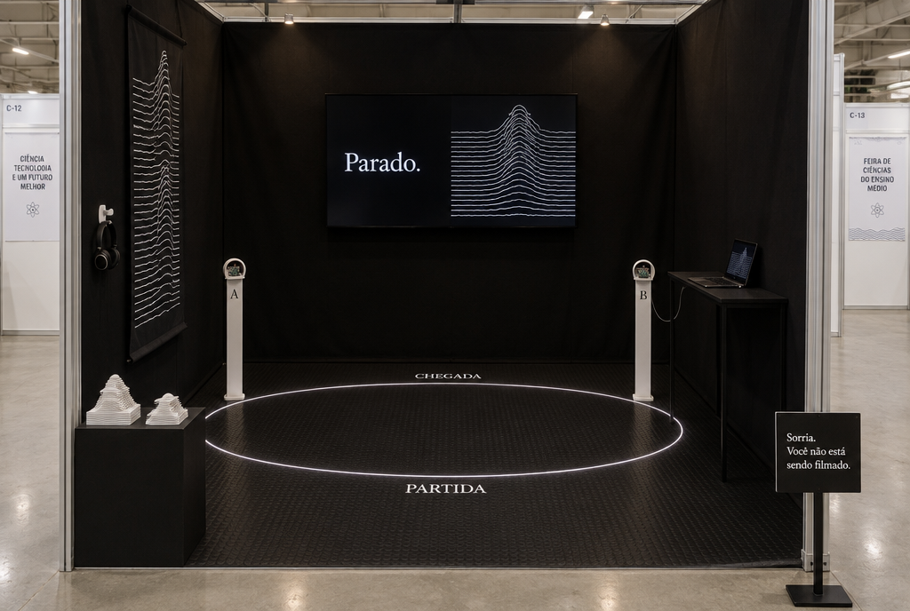
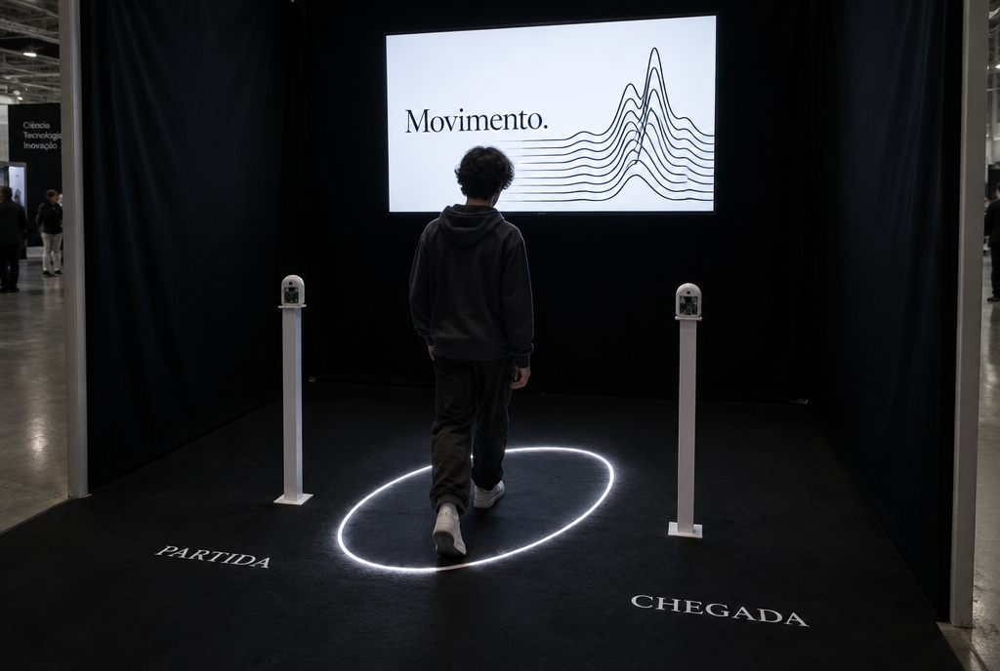

# Decoração do estande

Rascunho de 13/10/2026, para o grupo escolher. **Não gastem dinheiro antes de 15/10**, quando sai a lista dos selecionados.

## O conceito: "A sala que percebe"

O estande vira uma **caixa preta**, por dentro do sinal. As paredes ficam cobertas de tecido preto e as únicas marcas são linhas brancas, as mesmas da tela.

- **Destaque no salão:** os estandes da feira são brancos e bem iluminados (foto da JACITEC passada). Um estande preto chama atenção de longe.
- **A luz vem da tela:** quando alguém se mexe, a TV inverte para branco e **o estande inteiro acende**. Num estande branco ninguém percebe isso; num preto, vira o momento do estande.
- **Mesma linguagem do resto:** tela, pôster, cartão e estande falam a mesma língua (preto, branco, linhas, letra serifada). Isso conta na nota de **apresentação visual (10 pontos)**.

## Planta (vista de cima)

Medidas de exemplo para 2,5 m × 2 m. **Confirmar o tamanho real com a organização.**

```
                       parede do fundo (tecido preto)
  ┌──────────────────────────────────────────────────────────┐
  │                [ TV na altura dos olhos ]                │
  │ banner                  CHEGADA                  mesa    │
  │ vertical          .-~~~~~~~~~┃~~~~~~~~~-.       notebook │
  │ (nosso   A ▮ ····(  zona sensível ┃      )···· ▮ B  (cabo │
  │  estilo)          '-~~~~~~~~~┃~~~~~~~~~-'        USB)    │
  │ fone no                 PARTIDA                          │
  │ gancho                                                   │
  │ [esculturas]                       [placa "Sorria..."]   │
  └──────────────────────────────────────────────────────────┘
                        corredor do público
```

- **Sem mesa na frente.** A mesa vai para o lado, para o chão do estande virar a "arena". O visitante **entra**, em vez de ficar olhando de fora por cima da mesa.
- As placas A e B ficam nas laterais, a uns 2 m uma da outra. A faixa PARTIDA → CHEGADA cruza a linha entre elas, e o visitante anda de frente para a TV.
- O corredor fica a pelo menos 1 m da linha A–B, para quem passa não disparar a tela. **Testar no lugar.**

## Ideias, da mais fácil à mais ambiciosa

### Essencial (barato, e já muda tudo)

| Ideia | Como | Custo aproximado (conferir) |
|---|---|---|
| **Paredes pretas** | Tecido preto preso no **perfil de alumínio** com prendedor de papel (binder clip) ou presilha. Nada de prego ou fita nos painéis: ver as regras. TNT é o mais barato; malha ou helanca amassa menos. | TNT: R$ 30–50 · malha: R$ 150–250 |
| **Faixa e zona sensível no chão** | Fita branca formando a **elipse da zona sensível** (conta abaixo), mais PARTIDA e CHEGADA em letra serifada, impressas e plastificadas | R$ 20–40 |
| **Placas à mostra** | Cada placa num suporte de ~1 m (cano de PVC, tripé de câmera ou suporte de microfone), com a etiqueta "A · fala" e "B · escuta" | R$ 0–40 |
| **Placa de entrada** | **"Sorria. Você não está sendo filmado."** É a placa de câmera de segurança que todo brasileiro conhece, ao contrário. Embaixo, menor: "Mas o Wi-Fi sabe que você chegou." Puxa conversa sozinha. | Impressão: R$ 5–15 |
| **TV na altura dos olhos** | A feira não fornece notebook nem datashow. Uma TV ou monitor grande no fundo faz o "estande acende" funcionar. | Emprestada |

### Forte (impressora 3D + um pouco de dinheiro)

| Ideia | Como | Detalhe |
|---|---|---|
| **Cápsulas das placas** | Capa branca impressa para cada ESP32, com a placa visível por uma janela. Em cima de um poste de ~1 m, parece um objeto de museu. | Cerca de 7 × 5 × 9 cm e 3–5 h de impressão cada. Medir a placa antes (modelos de 38 e 30 pinos têm tamanhos diferentes). |
| **Escultura do sinal (para tocar)** | Cada linha da tela vira uma lâmina impressa em 3D, de uma **coleta de verdade**. São duas peças lado a lado: "sala vazia" (quase lisa) e "pessoa andando" (montanhas). | É o pôster "antes e depois" que dá para pegar na mão. Também funciona para visitantes cegos ou com baixa visão (inclusão conta na nota de impacto). Cerca de 15 × 15 cm e 5–10 h cada. Só com dado real. |
| **Elipse de LED** | Fita LED branca USB contornando a zona sensível no chão | R$ 25–60; ligar numa tomada ou power bank, longe do caminho dos pés |
| **Tatame preto (EVA)** | Peças de 50 × 50 cm formam a "arena" | 9 peças para 1,5 × 1,5 m: R$ 70–140 |
| **Cantinho do Superpoder** | Gancho impresso para o fone, uma máscara de dormir escrita "superpoder" e a frase "Feche os olhos." | Gancho: 1–2 h |
| **Troféu da Travessia** | Um por turno, para quem passou mais devagar sem ser visto | Pequeno, 1–2 h cada |
| **Brinde** | Chaveirinho de 3 cm com o relevo das linhas, impresso em lote durante a semana | 10–15 min cada |

### Ambicioso (se der tempo)

1. **Mapa de sensibilidade de verdade.**
   - Medir o tremor com uma pessoa em uns 20 pontos ao redor das placas.
   - Pintar o mapa no chão (ou no pôster) e comparar com a **zona de Fresnel** da teoria.
   - É ciência "de verdade" no chão do estande e responde a pergunta "onde ele me vê?". Ajuda nas notas de **profundidade** e **conhecimento científico**. Leva 1–2 h de medição com as placas. Eu faço o programa que gera o mapa.
2. **Biombo "parede".**
   - Um painel (papelão grosso ou MDF coberto de preto) dentro do estande. Alguém do grupo se mexe atrás dele.
   - Se o teste de parede der certo, é a demonstração mais forte do estande. Se não der, ele vira o lugar de dizer, com honestidade, até onde funciona.
3. **Registro de passagem impresso na hora.**
   - Uma impressora térmica de 58 mm (de comprovante) imprime o "Registro de passagem nº 042" com a marca em anéis, data e tremor máximo.
   - É preto e branco, como o resto. Custa uns R$ 120–250, e precisa adaptar a tela e testar antes.
4. **Cantinho "Ciência delas"** (tema da JACITEC).
   - Hedy Lamarr e George Antheil patentearam em 1942 o salto de frequência usando a ideia dos rolos de pianola (88 frequências, como as 88 teclas do piano).
   - Dá para mostrar uma tira de "rolo de pianola" impressa em 3D ao lado da melodia da marca do visitante: "ela transformou música em rádio; nós transformamos o seu movimento em música".

## A conta da zona sensível (para a elipse do chão)

O sinal entre A e B passa mais forte por uma região em forma de charuto, a **primeira zona de Fresnel**. É onde um corpo mais atrapalha o sinal. A largura no meio é:

> largura = 2 × √(λ × d / 4), com λ ≈ 12,2 cm (2,4 GHz) e d = distância entre as placas

| Distância entre A e B | Largura da elipse no meio |
|---|---|
| 1,5 m | 43 cm |
| 2,0 m | 49 cm |
| 2,5 m | 55 cm |
| 3,0 m | 60 cm |

É o modelo da teoria. Com as placas, testem se o tremor sobe mesmo mais dentro da elipse. Movimento fora dela também aparece, por causa dos reflexos nas paredes e nos móveis. Isso vira assunto para o avaliador ("conferimos a teoria com medição").

## Impressão 3D: lista e ordem

| Peça | Quando | Tempo estimado |
|---|---|---|
| Cápsulas A e B | Assim que medirem a placa | 2 × 3–5 h |
| Gancho do fone, troféus | Qualquer hora | 1–2 h cada |
| Escultura do sinal (2 peças) | Depois da primeira coleta real | 2 × 5–10 h |
| Chaveirinhos | Em lote, nas sobras de tempo | 10–15 min cada |

Eu posso gerar os arquivos (STL): a escultura sai direto de um `.csv` de coleta, e as cápsulas a partir das medidas da placa.

## Calendário até a feira (21–22/10)

| Dia | O quê |
|---|---|
| 14/10 | Perguntar à organização: tamanho do estande, se pode prender tecido no perfil, se tem tomada, se pode tirar a mesa da frente |
| 15/10 | Sai a lista. Se selecionados: comprar tecido, fita e EVA; começar as cápsulas |
| Placas chegam | Primeira coleta real → escultura e pôster com dado de verdade |
| 18–19/10 | **Montagem completa de ensaio** (sala de aula ou garagem): medir, fotografar, cronometrar |
| 20/10 | Impressões finais, checklist (`docs/apresentacao.md`) |
| 21–22/10 | Feira |

## Imagens de referência (geradas por IA)

As imagens abaixo foram geradas por IA (Higgsfield) **só para o grupo visualizar a ideia**. Não vão para o pôster nem para a tela: lá só entra coisa medida ou fotografada de verdade.

**O que a IA errou e não deve ser copiado:**
- A elipse real é **estreita**: cerca de 49 cm de largura por 2 m, ligando A a B, não um círculo largo.
- PARTIDA e CHEGADA ficam uma na frente e outra no fundo, cruzando a elipse.




