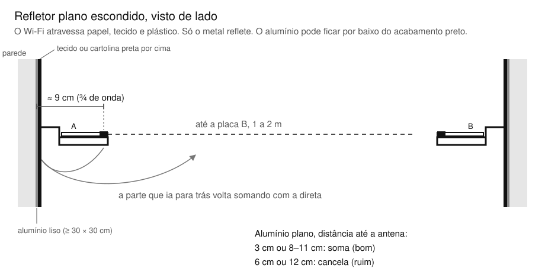
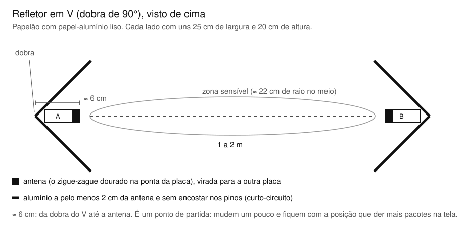

# Interferência na feira: o que aconteceu e o plano para a próxima

Feito em 24/11/2026, depois do 1º lugar na feira de ciências, para a próxima feira, em Vitória. Na apresentação chegavam poucos pacotes, às vezes nem o bastante para a tela atualizar, e a detecção falhava.

## Em um minuto

O problema tinha duas partes:
1. **O ar estava cheio.** Centenas de celulares, fones Bluetooth, o Wi-Fi do evento e muita gente (o corpo humano absorve essa onda) disputando a mesma faixa de 2,4 GHz.
2. **A Placa B piorava tudo.** O firmware oficial escuta todos os pacotes da sala e passa ~70% do tempo escrevendo na USB sem atender o rádio. Numa bancada calma isso passa; numa feira, não.

O plano tem três camadas, da mais barata para a mais cara:

| Camada | O que é | Custo | Estado |
|---|---|---|---|
| 1. Firmware v2 | A placa B para de escutar a sala inteira e de travar na USB; a A repete pacote perdido; a tela acha o canal mais livre e mostra onde os pacotes se perdem | R$ 0 | Pronto e compilado. **Falta testar nas placas** ([firmware/README.md](../firmware/README.md)) |
| 2. Refletor de alumínio | A "concha" que vocês improvisaram, feita na medida certa e escondida debaixo do preto | fita de alumínio e cartolina | Montar e medir |
| 3. Comprar | Placas com antena externa (mesmo firmware) ou placas de 5 GHz | de ~R$ 150 a ~R$ 400 (conferir) | Só se 1 e 2 não bastarem |

## O que aconteceu, explicado

**Só um fala de cada vez.** O Wi-Fi funciona como uma sala de aula: em cada canal, um aparelho fala de cada vez. Antes de falar, ele escuta; se alguém está falando, espera. Se dois falam juntos, ninguém entende nada (colisão). O exemplo oficial manda os pacotes em *broadcast*, o modo "falo uma vez e não confiro": se o pacote bateu com o de outro aparelho, perdeu.

**Quem estava falando na feira:**
- **Celulares**, mesmo sem usar a internet: eles perguntam "tem alguma rede aqui?" várias vezes por minuto, em todos os canais. Com centenas de pessoas, são milhares de perguntas.
- **Bluetooth** (fones, relógios, caixas de som): usa a mesma faixa de 2,4 GHz e pula de frequência 1.600 vezes por segundo, passando por cima de todos os canais do Wi-Fi.
- **O Wi-Fi do evento**, que tem muitos aparelhos ligados.

**O corpo humano.** O micro-ondas usa 2,45 GHz, quase a mesma frequência do Wi-Fi (2,4 GHz), porque a água absorve bem essa onda e esquenta. Nosso corpo é quase todo água. Uma multidão em volta das placas absorve e espalha o sinal.

**O LED e o metal.** Fontes de LED fazem ruído elétrico, mas quase todo em frequências bem mais baixas que 2,4 GHz; costuma pesar pouco, a não ser bem perto da placa. Não dá para descartar sem medir: se o LED estiver de novo perto, afastem as placas dele. Metal reflete a onda (em alguns pontos a onda refletida cancela a direta) e, a menos de 1 ou 2 cm da antena, desafina a antena.

**E a Placa B.** O exemplo oficial (`csi_recv`) liga o *modo promíscuo*: a placa recebe todos os pacotes do canal, de todas as redes, e só depois joga fora os que não são da Placa A. Além disso, escreve cada linha na USB (~14 ms) dentro da função que o Wi-Fi chama, e enquanto escreve não atende o rádio. A própria Espressif pede para não fazer isso. Em casa, com pouco tráfego, chegavam 86% a 92% dos pacotes; na feira, 20% a 40%.

## Camada 1: firmware v2

Está em [`firmware/`](../firmware/README.md). Em resumo:
- a B escuta só o que é para ela e escreve na USB por fora do rádio;
- a linha tem só os números que o detector usa (cabe o dobro de linhas por segundo);
- a A manda 100 pacotes por segundo direto para a B, e o rádio repete o pacote que a B não confirmou;
- 20 MHz em vez de 40 (um canal só, menos redes por cima);
- o botão **Procurar canal livre** mede os 13 canais e passa as duas placas para o melhor, sem regravar nada;
- o painel diz onde os pacotes se perdem: na A (canal ocupado), no ar ou na USB;
- o LED das placas mostra se os pacotes estão chegando, sem precisar de computador.

Para gravar, use os arquivos prontos pelo Chrome (passo a passo no [README do firmware](../firmware/README.md#como-gravar)).

## Camada 2: o refletor (por que a concha de alumínio funcionou)

**É parecido com o som?** É. Som, Wi-Fi e luz são ondas: refletem, se somam e se cancelam do mesmo jeito. O que muda é o tamanho, e o que importa é o tamanho do objeto comparado com o da onda:

| Onda | Tamanho da onda | O que funciona como espelho |
|---|---|---|
| Voz | 30 cm a 3 m | uma parede |
| Wi-Fi (2,4 GHz) | 12,5 cm | uma folha de alumínio de 25 cm |
| Luz | meio milésimo de milímetro | um espelho de bolso |

Um exemplo que dá para mostrar no estande: a porta do micro-ondas tem uma tela de metal com furinhos de 1 a 2 mm. Para a onda de 12 cm, furo tão pequeno é parede: ela fica presa dentro do forno. Para a luz, o furo é enorme: por isso dá para ver a comida.

**O que a concha fez:**
1. **Mais sinal na outra placa.** A parte da onda que ia para trás bate no alumínio e volta para a frente.
2. **Escudo.** O que vem de trás (o corredor, os celulares do público) bate no alumínio e não chega na antena.

**A distância importa.** A onda que bate no metal volta invertida, como se tivesse andado meia onda a mais. Se o metal fica a ¼ de onda (~3 cm) atrás da antena, a ida e a volta somam mais meia onda; com a inversão, dá uma onda inteira: a refletida sai junto com a direta e as duas se somam. A ¾ de onda (~9 cm) acontece o mesmo, com uma volta a mais. Já a ½ onda (~6 cm), elas saem desencontradas e **se cancelam**.

| Alumínio plano atrás da antena | Resultado (conta com 2 caminhos, canal 6) |
|---|---|
| ~3 cm | soma (quase o dobro), mas não cabe: a própria placa, de ~5 cm, está no caminho |
| ~6 cm | **cancela** |
| 8 a 11 cm | soma (de 1,6 a 2 vezes) |
| ~12 cm | **cancela** |

### Versão recomendada: escondida, sem nada à mostra

**O Wi-Fi atravessa papel, tecido, papelão e plástico quase sem perda.** Só o metal (e a água) importam. Então o alumínio pode ficar **por baixo** do acabamento preto do estande, sem ninguém ver.

E tem uma coincidência boa: o suporte de parede (`hardware/suporte_placa`) deixa a antena a **~9,4 cm da parede**, quase exatamente ¾ de onda (9,1 a 9,3 cm, conforme o canal). A própria parede já está na distância certa para refletir.

**Com as placas na parede (suportes impressos):**
1. Cole um quadrado de alumínio liso de **pelo menos 30 × 30 cm** na parede, centrado onde vai o suporte. O melhor é **fita de alumínio adesiva** (fita aluminizada, de loja de material de construção), em tiras lado a lado: fica lisa e firme. Papel-alumínio colado num papelão também serve.
2. Cubra com o tecido preto do estande ou com uma cartolina preta.
3. Cole o suporte por cima, no lugar de sempre. A antena fica a ~9,4 cm do alumínio, sem precisar medir.

**Com as placas numa mesa:** uma placa preta em pé atrás de cada uma (papelão, cartolina ou isopor de ~30 × 30 cm, com o alumínio no verso), a **~9 cm da ponta da antena**, ou seja, uns 4 cm atrás do conector USB. Essa placa pode levar a letra **A** ou **B** em branco, na fonte da tela: vira sinalização do estande, e por trás é um espelho para o Wi-Fi. Também dá para contar isso ao visitante.

**Cuidado:** o alumínio não pode encostar nos pinos da placa (curto-circuito). Na parede, o tecido ou a cartolina já isolam.

### Alternativa: o V (ou a concha)

Um V de 90° em volta da placa concentra mais, mas aparece mais. A regra do V é outra: a antena fica a ~6 cm **da dobra** (a conta do V tem três reflexos, não um, e por isso dá diferente da placa plana).

1. Dois pedaços de papelão de ~25 cm × 20 cm, colados com fita formando um V de 90° (como um livro meio aberto).
2. Alumínio liso por dentro do V e cartolina ou tecido preto por fora e por dentro, para esconder.
3. A placa no meio do V, com a antena virada para a abertura, a ~6 cm da dobra; a abertura virada para a outra placa.

**Em qualquer versão, meçam.** A antena da placa é uma trilha no circuito, não uma antena de livro, e as contas acima usam só dois caminhos. Mudem a distância de 1 em 1 cm e fiquem com a que der mais **chegaram/s** e o maior **RSSI** na tela.

**Bônus:** o refletor também barra o que vem de trás (o estande vizinho, o corredor). O V, além disso, estreita a zona sensível para a linha entre as placas.

**Vira um experimento para o estande:** medir RSSI e pacotes por segundo sem refletor e com o alumínio a 6, 9 e 12 cm da antena (a 6 cm ele fica logo atrás do conector USB), na mesma montagem. Se o de 9 cm melhorar e os de 6 e 12 cm piorarem, vocês mostraram a interferência das ondas com o próprio projeto. "Medimos: com o refletor, o sinal subiu X dB" é ciência de verdade e cabe numa frase.

## Teste em casa antes da feira

Uns 40 minutos. Mandem um print do painel ao final.

1. **Gravar** as duas placas com o firmware v2 ([passo a passo](../firmware/README.md#como-gravar)).
2. **Ligar:** A no carregador, B no notebook. Em alguns segundos, o LED azul das duas deve ficar **aceso**.
3. **Tela:** abra `demo/index.html` no Chrome, tecla **O**, **Placa USB**. Deve aparecer a seção **Rádio (firmware v2)**, com **A mandou/s** perto de 100 e **chegaram/s** perto disso.
4. **Feira de mentira:**
   - ponha a Placa B **ao lado do roteador** (em 15/10 isso derrubou para 42/s com o firmware oficial);
   - num celular ligado nesse roteador, toque um vídeo em alta resolução;
   - anote **chegaram/s** e a frase do painel;
   - clique em **Procurar canal livre**, espere uns 5 s e anote o canal escolhido e os números novos.
5. **Detecção:** volte as placas para 1,5–2 m, calibre (**C**) com a faixa vazia e faça umas travessias.
6. **Refletor:** com a mesma montagem, compare sem e com o alumínio atrás (anote RSSI e chegaram/s). Se der, teste também a 6 e a 12 cm, para ver o cancelamento de verdade.

Se algo não funcionar, copiem o que aparece na seção Rádio (ou as linhas `WS_` do `idf.py monitor` da placa B) e mandem.

## Camada 3: se ainda não bastar

Só vale comprar se, depois das camadas 1 e 2, o painel ainda disser que os pacotes **se perdem no ar** ou **nem saem da Placa A** em todos os canais.

| Opção | O que comprar | Custo (conferir) | Prazo | Firmware |
|---|---|---|---|---|
| **A. Antena externa** | 2× ESP32 DevKit com o módulo **ESP32-WROOM-32U** (tem um conector IPEX/U.FL no lugar da antena de trilha) + 2× antena de 2,4 GHz com cabo IPEX → RP-SMA | placa: parecida com a de vocês; antena com cabo: algumas dezenas de reais | Mercado Livre: dias | o mesmo v2, sem mudar nada |
| **B. Antena direcional** | O mesmo, com antena painel (patch) ou yagi de 2,4 GHz (8 a 14 dBi) | mais cara | dias a semanas | o mesmo v2 |
| **C. Outra frequência (5 GHz)** | 2× **ESP32-C5-DevKitC-1** (Wi-Fi em 2,4 e 5 GHz) | ~US$ 15 cada + frete (AliExpress, no lançamento) | importado: 2 a 4 semanas | precisa adaptar o v2 |

**Antena externa (A e B).** O mesmo chip, então o firmware v2 grava igual. A antena de trilha da placa de vocês é pequena e fica colada no circuito; uma antena de verdade, longe da placa, recebe melhor. Uma antena direcional é o refletor feito de fábrica: concentra o sinal na direção da outra placa e ignora o que vem dos lados e de trás. Ao comprar, confiram no anúncio que o módulo é o **32U** (o 32D e o 32E têm antena de trilha) e se a antena vem junto. **Nunca liguem a placa 32U sem a antena conectada.**

**5 GHz (C).** É a resposta ao "trabalhar em outra frequência":
- **Menos disputa:** Bluetooth, micro-ondas e os pedidos dos celulares ficam quase todos em 2,4 GHz. Em 5 GHz há mais canais e eles não se sobrepõem.
- **Onda menor (6 cm):** percebe movimentos menores, mas atravessa menos corpo e parede (o teste "atrás da parede" deve piorar).
- **Controle de ganho:** o ESP32-C5 compensa o ganho automático do rádio, o problema que hoje o detector corrige à mão (`normalizar_volume`).
- **Confirmado na documentação:** a própria Espressif tem um exemplo com duas ESP32-C5 trocando pacotes ESP-NOW em 5 GHz (canal 40) para medir CSI (`esp-csi/examples/esp-crab`).
- **Contra:** placa mais nova, mais difícil de achar no Brasil, e o firmware v2 precisaria de adaptação (outro formato de CSI). Com prazo curto, a opção A é mais segura.

**Por que não dá para prometer 100%.** Se a faixa de 2,4 GHz estiver lotada em todos os canais, nenhum ajuste em 2,4 GHz resolve: o painel vai mostrar "nem saem da Placa A" em todos eles. Aí é a vez do 5 GHz. A vantagem do firmware v2 é que agora dá para **saber** qual é o caso, em vez de adivinhar.

## No dia da feira

1. **Montar** o alumínio na parede (debaixo do tecido) e as placas nos suportes por cima, na mesma altura e na posição marcada com fita.
2. **Silenciar o que é de vocês:** Wi-Fi e Bluetooth do notebook desligados (a USB continua funcionando), roteador do celular desligado, celulares do grupo longe das placas.
3. **Ligar** a A no carregador de tomada e a B no notebook. Conferir o LED.
4. **Tela:** tecla O, **Placa USB**, esperar a seção Rádio.
5. **Procurar canal livre** com o estande vazio. Quando a feira encher (o melhor canal muda ao longo do dia), procurar de novo.
6. **Calibrar** (C) com a faixa vazia, sempre depois de trocar de canal.
7. **Ler a frase do painel:**

| O painel diz | O que fazer |
|---|---|
| Funcionando | nada |
| nem saem da Placa A | procurar canal livre; se continuar, o canal está lotado em todo lugar (ver Camada 3) |
| se perdem no ar | aproximar as placas (1 a 1,5 m), antenas viradas uma para a outra, refletor, afastar de metal e do LED; depois procurar canal livre |
| não cabem na USB | fechar outros programas, ligar a placa direto no notebook (sem hub), notebook na tomada |
| não está ouvindo a Placa A | conferir se a A está ligada e com LED; a B procura sozinha em todos os canais |

8. **Plano B:** se nada funcionar, **Gravação…** com uma coleta boa, e dizer ao visitante que é gravação.

## Fontes

- Espressif, guia de Wi-Fi do ESP-IDF, seção CSI: a função de recepção do CSI roda na tarefa do Wi-Fi; "não faça operações demoradas nela, mande os dados para uma fila e trate numa tarefa de prioridade menor". https://docs.espressif.com/projects/esp-idf/en/latest/esp32/api-guides/wifi-driver/wifi-vendor-features.html
- Exemplo oficial `csi_recv` (modo promíscuo e impressão dentro da função): https://github.com/espressif/esp-csi/tree/master/examples/get-started/csi_recv
- Ferramenta avançada da própria Espressif (`esp-radar/console_test`), que já usa fila, só LLTF e desliga o modo promíscuo: https://github.com/espressif/esp-csi/tree/master/examples/esp-radar/console_test
- ESP-NOW: o unicast tem confirmação e repetição; o broadcast sai uma vez só. https://docs.espressif.com/projects/esp-idf/en/v5.5.5/esp32/api-reference/network/esp_now.html
- ESP32-C5 com ESP-NOW em 5 GHz para CSI: https://github.com/espressif/esp-csi/tree/master/examples/esp-crab
- Lançamento da ESP32-C5-DevKitC-1 (US$ 15): https://www.cnx-software.com/2025/04/30/esp32-c5-mass-production-esp32-c5-devkitc-1-board/
