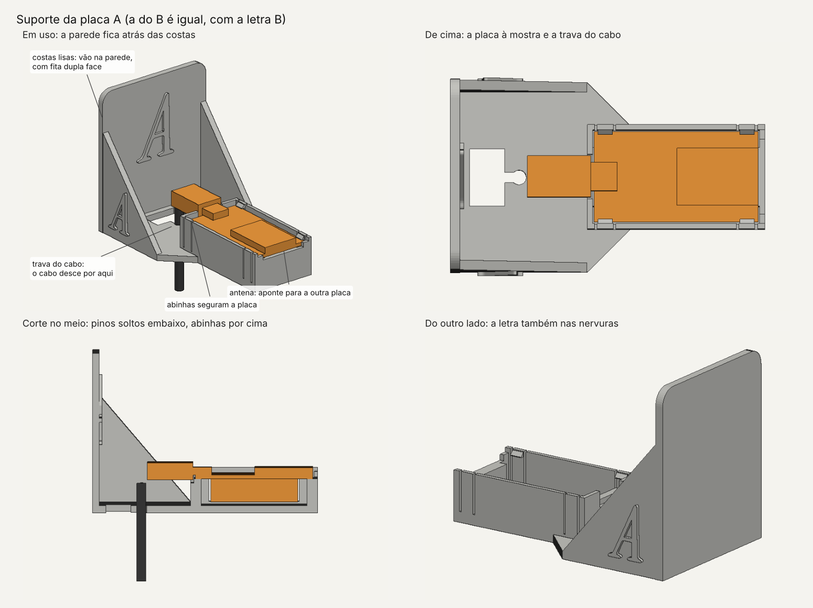

# Suporte de parede para as placas A e B

Uma prateleirinha impressa em 3D que vai colada na parede com fita dupla face. A placa ESP32 fica deitada, à mostra, presa por quatro abinhas, com a antena virada para a outra placa.



## Arquivos

| Arquivo | O que é |
|---|---|
| `teste_encaixe.stl` | Só a bandeja da placa. **Imprima primeiro** (uns 30 min) para conferir se a placa encaixa. |
| `suporte_A.stl` | O suporte da placa A (a que fala), com a letra A. |
| `suporte_B.stl` | O suporte da placa B (a que escuta), com a letra B. |
| `suporte.py` | O programa que gera os três arquivos. As medidas ficam no topo dele. |

## Como imprimir

- **Material:** PLA (ou PETG).
- **Posição:** a que o arquivo já tem: a prateleira deitada na mesa e as costas em pé. **Não precisa de suporte.**
- **Configuração:** camada de 0,2 mm, 4 perímetros (paredes), 20% de preenchimento e bico de 0,4 mm.
- **Tempo e filamento:** o fatiador (Cura, PrusaSlicer, Bambu Studio, Creality Print…) mostra. Cada suporte tem uns 36 cm³ se fosse maciço; com 20% de preenchimento, gasta bem menos que 45 g.

### No Bambu Studio (Bambu Lab)

1. **Posição:** abra os arquivos **sem girar** e não use a orientação automática. A posição em que eles abrem já é a de imprimir.
2. **Mesa e filamento:** Textured PEI (ou Cool Plate com cola bastão), Bambu PLA Basic ou outro PLA.
3. **Processo:** `0.20mm Standard @BBL`.
4. **Força (Strength):**
   - **Wall loops: 4.** As abinhas e as paredes da bandeja têm 1,6 mm; com 4 voltas, saem maciças e mais firmes.
   - **Sparse infill density: 20%**, com padrão grade ou giroide.
5. **Suporte:** **"Enable support" desmarcado.**
   - As letras em relevo e as abinhas têm partes viradas para baixo, mas são balanços curtos (1,2 mm e 1,5 mm), que a impressora faz no ar.
   - Suporte dentro da bandeja ou nas fendas das abinhas seria difícil de tirar e poderia quebrar uma abinha.
6. **Outros:**
   - **Brim:** não precisa, porque a base é larga.
   - **"Detect thin wall":** ligado, para os traços finos da letra saírem.
7. **Ordem:**
   - Imprima primeiro o `teste_encaixe.stl` sozinho.
   - Se a placa encaixar, coloque o A e o B juntos numa mesa só. Cabem até na A1 mini (180 × 180 mm).

Se uma letra sair com algum fiapo embaixo, uma lixa ou um estilete resolve.

## Como montar

1. **Teste de encaixe.** Ponha a placa na bandeja com o USB para o lado do recorte e aperte até as quatro abinhas estalarem por cima da borda. Os pinos ficam soltos embaixo, sem encostar em nada.
   - Ficou apertado ou não entrou: aumente `FOLGA` (por exemplo, para 0,7) e gere de novo.
   - Ficou frouxo: aumente `ABA` (por exemplo, para 1,8).
2. **Cabo.**
   - Passe o plugue USB-C de baixo para cima pela janela do piso e ligue na placa.
   - Empurre o cabo para o furinho redondo da trava: ele entra apertado e fica preso.
   - Assim, o peso do cabo fica na prateleira, não no conector.
3. **Parede.**
   - Limpe a parede com um pano seco.
   - Cole fita dupla face **de espuma** nas costas, cobrindo o máximo que der, e aperte contra a parede por 30 segundos.
   - Cola quente solta de parede pintada e pode arrancar a tinta. Confirmem com a organização se pode colar.
4. **Posição.**
   - As duas placas ficam na **mesma altura** (~1 m), com a ponta da antena virada para a outra placa, a 2–3 m de distância.
   - Depois de colar, calibre com a faixa vazia (tecla `C`).

## Se a placa não encaixar no teste

Meça a placa com uma régua ou um paquímetro, mude os números no topo do `suporte.py` e rode de novo:

```
pip install manifold3d numpy matplotlib fonttools brotli
python hardware/suporte_placa/suporte.py
```

| Medida no `suporte.py` | O que medir | Padrão |
|---|---|---|
| `PLACA_C` | Comprimento da placa, do USB até a ponta da antena | 51,5 mm |
| `PLACA_L` | Largura da placa | 28,5 mm |
| `PINOS` | Quanto os pinos descem abaixo da placa | 11 mm |
| `CABO` | Grossura do cabo USB | 4 mm |
| `PLUGUE_L`, `PLUGUE_A` | Largura e altura da capa de borracha do plugue USB-C | 13 × 7,5 mm |

O programa confere tudo antes de salvar:
- a peça fica fechada (sem buracos na malha);
- a placa encaixa sem encostar em nada;
- as quatro abinhas passam por cima da borda da placa;
- os cantinhos seguram a placa na ponta da antena;
- a trava é mais estreita que o cabo;
- nada precisa de suporte de impressão (fora as abinhas e o relevo das letras, que são pequenos e imprimem sem suporte).

Ele escreve "Tudo certo." no fim, ou diz o que deu errado.

## Por que assim

- **Sinal:** plástico quase não atrapalha o Wi-Fi. O que atrapalha é metal perto da antena. A antena fica na ponta aberta da bandeja, a uns 9 cm da parede.
- **Fita:** as costas são lisas e largas (60 × 70 mm), para caber bastante fita.
- **Pinos:** a placa apoia em dois degraus nas pontas curtas, no meio. Os pinos ficam soltos num poço embaixo, então não importa a distância exata entre as duas fileiras.
- **Letra:** a letra é a Instrument Serif itálica, a mesma do A e do B da tela. Ela aparece na frente das costas e nas duas nervuras, para quem passa pelo lado também ver.
